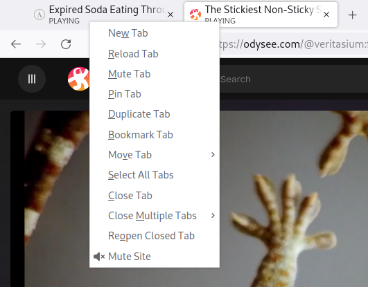

# Mute Site
This is a Firefox extension that allows to instantly mute/unmute all tabs from a website. The mute button appears when a tab is playing audio. When pressed, it will toggle mute on all tabs from that domain. By default muted domains will be forgotten after restarting the browser, but you can change that in addon's settings.

Available here: https://addons.mozilla.org/firefox/addon/mute-site/




## Building
```
npm install
npm run build
```

This will create a file `firefox-mute-site.zip`. You can load it in your browser by going to `about:debugging` in the URL bar, then clicking on `This Firefox` and `Load Temporary Add-on...`. It should then appear on your list of extensions.

## Donate
If you would like to donate some Monero (XMR), you can do it using the following address:\
`89MpdQJqV6G5XarB9hFJ8Mb8Bx4V4Gf3YEkEsg6L5WCLBUHM6TW8KSPbwG6DyUqJdEgGZsPZ4k6cTAMnc6rMyReZ9KPd2TG`

## License
This program is free software: you can redistribute it and/or modify
it under the terms of the GNU General Public License as published by
the Free Software Foundation, either version 3 of the License, or
(at your option) any later version.

This program is distributed in the hope that it will be useful,
but WITHOUT ANY WARRANTY; without even the implied warranty of
MERCHANTABILITY or FITNESS FOR A PARTICULAR PURPOSE.  See the
GNU General Public License for more details.

You should have received a copy of the GNU General Public License
along with this program.  If not, see <https://www.gnu.org/licenses/>.

Icons come from [Font Awesome](https://fontawesome.com) - CC BY 4.0 license.